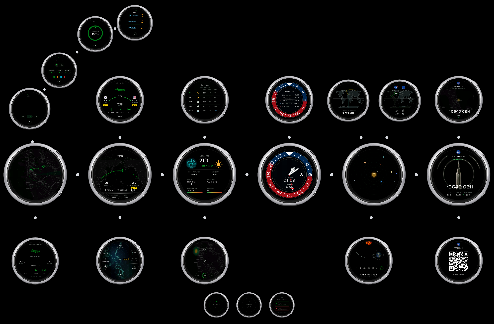
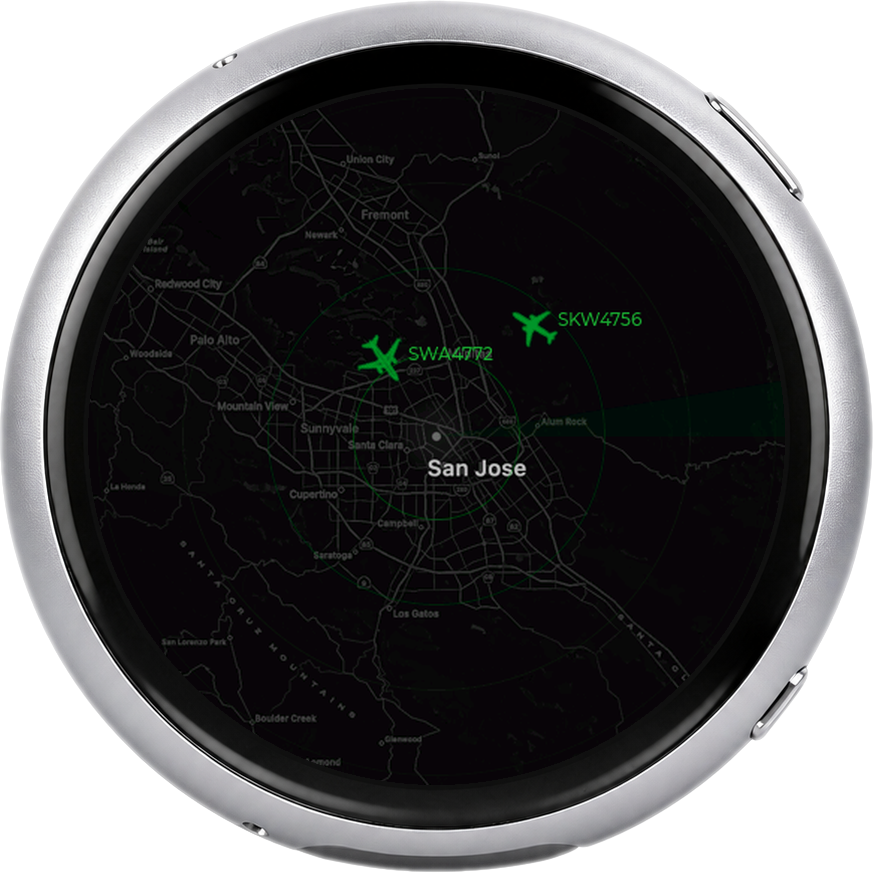
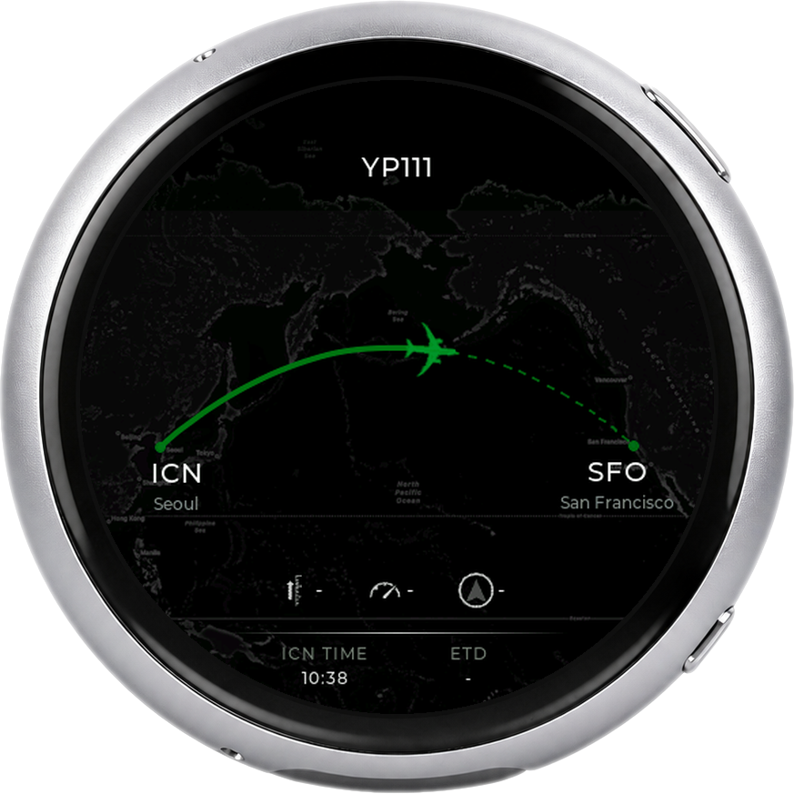
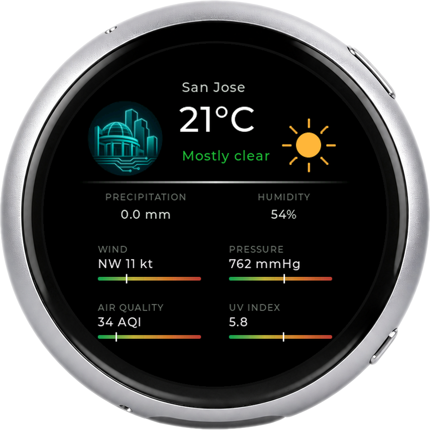
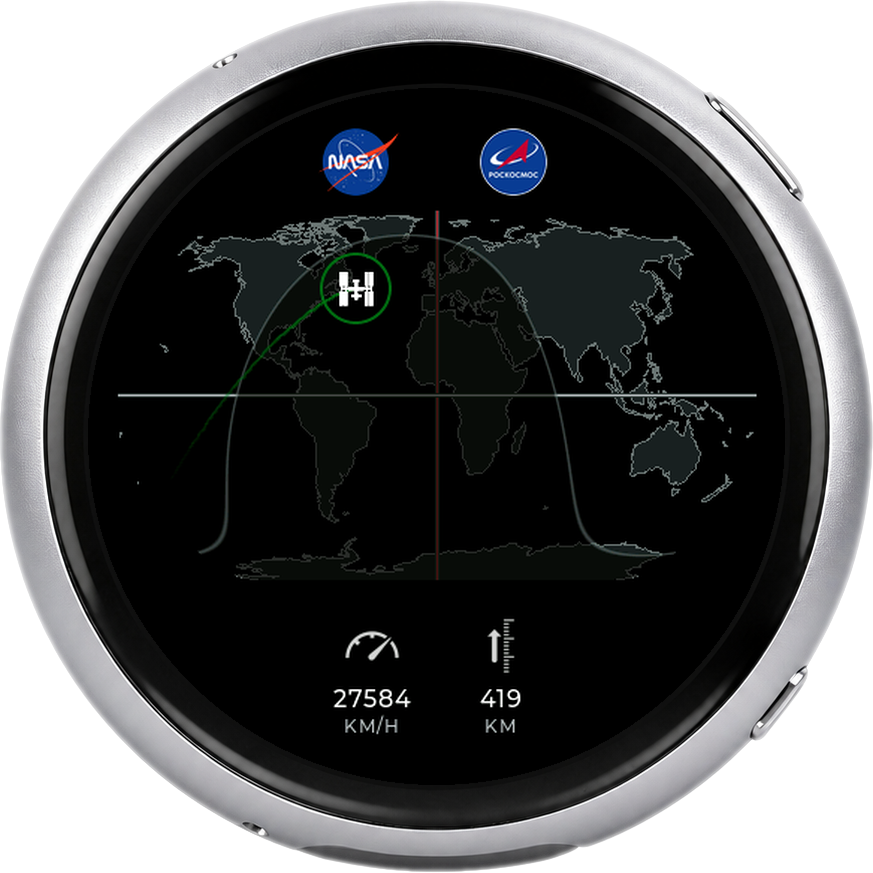
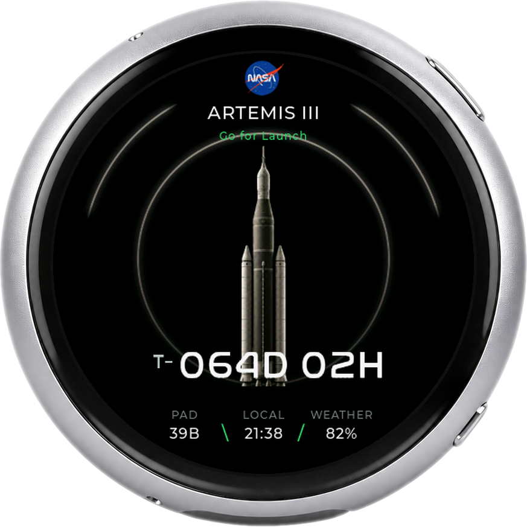

<div align="center">

# AirESP32ace

### A tiny, cinematic aerospace instrument for your desk

ESP32-S3 firmware and a native macOS companion for a 466 × 466 circular AMOLED display.

[](LICENSE)
[](https://docs.espressif.com/projects/esp-idf/en/stable/esp32s3/get-started/)
[](companion/AirspaceCompanion)
[](https://docs.waveshare.com/ESP32-S3-Touch-AMOLED-1.75C)

</div>

<div align="center">
  
  <br />
  <sub>The complete interaction map: six main worlds, their alternate views, settings, power controls, and Dock Mode.</sub>
</div>

<br />

<table>
  <tr>
    <td></td>
    <td></td>
    <td></td>
  </tr>
  <tr>
    <td align="center"><b>Local radar</b></td>
    <td align="center"><b>Flight tracker</b></td>
    <td align="center"><b>Weather</b></td>
  </tr>
  <tr>
    <td></td>
    <td></td>
    <td valign="middle"><b>One circular instrument.</b><br/>Aircraft, weather, time, the solar system, ISS passes, and crewed launch schedules.</td>
  </tr>
</table>

## What it does

- Renders a smooth local aircraft radar with real icons, predicted motion, selectable range, callsigns, and aircraft detail views.
- Tracks planned flights in Live Route, Straight-line Route, and Details views.
- Shows current weather, a five-day forecast, and animated radar imagery for the selected city.
- Includes a GMT-style world clock, sunrise/sunset bezel, and configurable city list.
- Computes a live solar-system view and lunar phase, animates the next total solar eclipse, and tracks the ISS over a generated world map.
- Follows selected NASA, Roscosmos, and SpaceX/Starship launch schedules directly on the device, even with the Mac closed.
- Provides touch, two-button navigation, sleep/power controls, brightness adjustment, and an automatic Dock Mode.
- Uses a native SwiftUI companion to configure the device, manage cities and flights, render maps, validate API credentials, preview every device screen, and install firmware.

The firmware is optimized around the limits of an ESP32-S3: persistent RGB565 assets live in flash, working buffers use PSRAM deliberately, and small overlays are updated independently so animations do not require full-screen redraws.

## Hardware

| Part | Link | Notes |
|---|---|---|
| Display/controller | [Waveshare ESP32-S3-Touch-AMOLED-1.75C](https://docs.waveshare.com/ESP32-S3-Touch-AMOLED-1.75C) | ESP32-S3R8, 8 MB PSRAM, 32 MB flash, 466 × 466 CO5300 AMOLED, CST9217 touch, AXP2101 PMIC. Approximately US$40 from AliExpress when this project was built; availability and pricing vary. |
| Desk dock | [Magnetic phone/watch stand](https://a.co/d/012B5Kl2) | The compact dock shown with the project. Any stable stand with USB-C clearance should work. |
| USB-C cable | Any data-capable cable | Required for first setup and wired firmware recovery. |
| Mac | Apple silicon recommended | Builds and runs the native companion app. |

## Repository layout

```text
firmware/airspace-instrument/   ESP-IDF firmware
companion/AirspaceCompanion/   Native SwiftUI macOS app
shared/native_renderer/        Device renderer hosted by the Mac preview
assets/                        Project-created static artwork and registries
Cities/                        Default city artwork
release/firmware/              Ready-to-flash ESP32-S3 binaries and offsets
release/macos/                 Ready-to-run macOS app archive and checksum
docs/guides/                   Device and companion PDF guides
scripts/                       Build and asset-generation helpers
```

## Quick start

### 1. Flash the ready-made firmware

The [firmware release folder](release/firmware) contains the app, bootloader, and partition-table binaries for the Waveshare ESP32-S3-Touch-AMOLED-1.75C. It contains no Wi-Fi or API credentials. Follow its README for the exact offsets, then complete Wi-Fi, provider, city, and map setup in the companion.

### 2. Run the ready-made Mac companion

Download [AirESP32ace-macOS.zip](release/macos/AirESP32ace-macOS.zip), unzip it, then Control-click **AirESP32ace.app** and choose **Open**. This build is ad-hoc signed but not notarized with Apple; macOS may require one confirmation in **System Settings → Privacy & Security**. No Apple Developer account is required.

The archive is built from the source in this repository and includes the native device renderer and firmware installer resources. Its SHA-256 checksum is published in [release/macos/SHA256SUMS](release/macos/SHA256SUMS).

Version **0.1.4** fixes worldwide airport city labels, keeps Tracker countdown-only until one hour before estimated departure, and displays confirmed delays from device-owned schedule checks. Firmware updates now exclusively own USB and restart the ESP32-S3 with a watchdog reset. Packaging uses the current toolchain's actual build output. The receiving Mac needs no Python, ESP-IDF, Homebrew, or Xcode. Install the matching firmware and companion together, then Sync existing flights once to repair saved city labels without resetting live progress. The Mac prescribes flights and artwork; the device refreshes data over Wi-Fi. See [autonomous flight tracking](docs/autonomous-flight-tracking.md).

The matching app, application-only firmware, and checksums are also available as separate downloads in the [v0.1.4 GitHub release](https://github.com/vmalis/AirESP32ace/releases/tag/v0.1.4). Earlier releases remain unchanged.

After **Set Up New Device**, enter the device's assigned Wi-Fi address in Settings and choose **Install device content**. Wait for the verification receipt. This installs the selected cities' three radar-map ranges plus Weather/Space artwork. **Update Firmware** preserves settings and content; **Set Up New Device** erases the entire board. Charlotte (CLT) and Columbia, South Carolina (CAE), are optional Mac-side replacements—the device still holds at most eight cities.

### 3. Run the Mac companion from source

Requirements: macOS 15 or newer, Xcode with Command Line Tools, and Git.

```bash
git clone https://github.com/vmalis/AirESP32ace.git
cd AirESP32ace/companion/AirspaceCompanion
swift run AirESP32ace
```

That launches the companion directly from Swift Package Manager. Configuration and API credentials are stored locally; they are never part of this repository.

For a self-contained development `.app` with the exact native device renderer:

```bash
cd AirESP32ace
./companion/AirspaceCompanion/scripts/build_app_bundle.sh debug
open "companion/AirspaceCompanion/.build/arm64-apple-macosx/debug/AirESP32ace.app"
```

The full bundle expects the firmware dependencies to have been resolved once, as described below. Local builds use ad-hoc signing, so no Apple Developer certificate is required.

### 4. Build the firmware

Install [ESP-IDF 5.5 or newer](https://docs.espressif.com/projects/esp-idf/en/stable/esp32s3/get-started/) and activate its environment, then:

```bash
cd AirESP32ace
./scripts/idf.sh firmware/airspace-instrument set-target esp32s3
./scripts/idf.sh firmware/airspace-instrument menuconfig
./scripts/idf.sh firmware/airspace-instrument build
```

In `menuconfig`, open **AirESP32ace** and enter the initial Wi-Fi/location values. The generated `sdkconfig` contains local credentials and is ignored by Git.

### 5. Flash and connect

Find the board's serial port:

```bash
./scripts/list-ports.sh
```

Then flash and monitor it (replace the port with yours):

```bash
./scripts/idf.sh firmware/airspace-instrument \
  -p /dev/cu.usbmodemXXXX flash monitor
```

Once the device joins Wi-Fi, open the companion, enter its IP address, add any optional API credentials, choose **Sync**, and let the Mac generate the map packs. The in-app **Device** panel can also provision a new board or install a later firmware build over USB-C.

## Data services

The project is designed to remain useful when one provider is unavailable.

- **OpenSky Network** supplies nearby-aircraft state vectors for Radar and live airborne telemetry for a selected tracked flight.
- **FlightAware AeroAPI** is the primary tracked-flight source for the exact selected occurrence, route, schedule, terminal/gates, ETD, and ETA when configured.
- **AirLabs** is the tracked-flight fallback when FlightAware is unavailable or does not return the selected occurrence.
- Public weather and launch-schedule endpoints provide their respective screens.

The ESP32 owns scheduled-flight and launch updates and continues refreshing with the Mac closed. FlightAware supplies designated-flight schedules/gates and conservative telemetry fallback; OpenSky supplies airborne positions and nearby Radar traffic. AirLabs provides fallback/enrichment. Provider credentials are provisioned separately onto the device and are never embedded in downloadable firmware or the app. On a different Mac, blank API fields preserve keys already held by the device; enter provider credentials separately when the new Mac needs to look up and prescribe flights.

Accounts, availability, quotas, and permitted uses are controlled by each provider. Bring your own credentials and review their terms before use. The API status page performs a lightweight authorization check; having a field filled in is not treated as proof that the credential is active. FlightAware uses the no-cost account-usage probe, not the tier-restricted alerts API. A changed key is revalidated by the device.

## Maps and artwork

The original project-created artwork is included, including the exact startup image used on the device, aircraft source sheets, city art, weather art, and launch assets. Pre-rendered map packs and downloaded airline logos are intentionally **not** committed: the companion generates maps for your selected cities/routes and caches airline artwork locally at runtime. The proprietary watch mark is also omitted.

See [Asset and data policy](docs/ASSET_POLICY.md) for the exact boundary.

## Guides

The project maintains one standard edition of each guide.

- [Getting started (PDF)](docs/guides/AirESP32ace_Getting_Started.pdf)
- [Device interaction guide (PDF)](docs/guides/AirESP32ace_Device_User_Guide.pdf)
- [Complete screen map (PDF)](docs/guides/AirESP32ace_Screen_Map.pdf)
- [Mac companion guide (PDF)](docs/guides/AirESP32ace_Companion_User_Guide.pdf)
- [Build and troubleshooting notes](docs/BUILDING.md)

## Project story

AirESP32ace was created over four evenings as an AI-assisted, “vibe coding” project—but the direction was deliberate: screen composition, interaction design, map projections, buffering strategy, PSRAM use, partial redraws, and hardware behavior were all guided and tested on the real device. The goal was not a generic demo; it was a polished little instrument that belongs beside a Studio Display.

## Contributing

Issues and focused pull requests are welcome. Please read [CONTRIBUTING.md](CONTRIBUTING.md) and do not commit API keys, generated map caches, downloaded airline marks, the proprietary watch mark, build outputs, or proprietary fonts.

## Support

The project is free and open source. If you publish a derivative, a link back is appreciated. If it was useful or simply entertaining, you can optionally [buy me a coffee](https://ko-fi.com/vm216261). No donation is required to use any part of the project; see [SUPPORT.md](SUPPORT.md).

## License and notices

Source code and project-authored assets are released under the [MIT License](LICENSE), except the separately executed firmware installer helper, which is marked GPL-2.0-or-later. The app includes its helper source, matching esptool source archive, and dependency notices under `Contents/Resources/ThirdParty/FirmwareTool`. Third-party data and runtime-downloaded artwork remain subject to their respective owners' terms. AirESP32ace is an independent personal project and is not affiliated with Waveshare, Apple, OpenSky, FlightAware, AirLabs, NASA, Roscosmos, SpaceX, or any airline.

Designed and directed by **Vadim Malis**.
